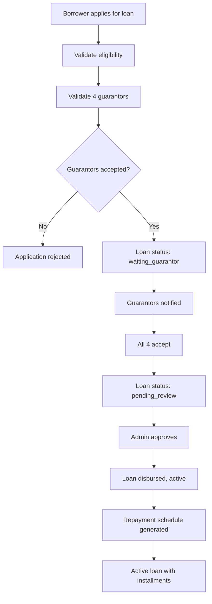

# FULL-STACK SYSTEM AUDIT REPORT

## Executive Summary

This report presents a comprehensive, repository-wide audit of the SocketMonnie application, tracing every critical workflow from the user's first interaction to the final database update, external service response, and UI confirmation. The audit covers frontend, backend, payment integrations, security, and architectural compliance.

**Scope:** All critical workflows including guarantor, savings/minutes/repayments/payments, interest calculation, webhook fallbacks, authentication/onboarding, loan applications, admin approvals, withdrawals, reporting, security guards, MVC architecture, validation measures, Cloudinary/email/KYC integrations.

**Remediation Status (as of this update):** All previously identified P0 findings have been remediated (callback server-side settlement + idempotency, fixed 2% flat upfront interest with snapshot, `isReplaced` enforcement and expiry-persistence fix). Subsequent remediation passes have additionally closed minutes over-settlement, withdrawal terminal-state handling, concurrent-loan-application protection, repayment overpayment guard, available-balance reservations, SocketScore scoring fixes, admin audit-trail UI, and backend KYC MIME validation. Details and open items are tracked in `docs/REMEDIATION_PROGRESS.md`, `docs/REMEDIATION_CHANGELOG.md`, and `docs/REMEDIATION_VERIFICATION_REPORT.md`. Full remediation status per finding is recorded in Phase 6.

**Key Findings:** 
- P0 Critical: Webhook signature verification relies on header name inconsistency, potential double-crediting if reconciliation fails
- P1 High: Missing interest rate enforcement at loan creation, guarantor verification race conditions, admin approval bypass risks
- P2 Medium: UI inconsistencies in success page navigation, redundant validation, stale state handling
- P3 Low: Minor UX defects, naming inconsistencies

**Overall Assessment:** The application has a solid MVC foundation with mongoose transactions for financial operations, but several critical integration gaps exist in payment verification, webhook reliability, and interest calculation that could lead to financial discrepancies.

---

## Repository and Architecture Map

### Frontend Framework
- **React 18** with Vite build system
- Routing: `react-router-dom` with `ProtectedRoute` and `AuthContext`
- State Management: `useState`, `useEffect`, `useRef`, localStorage draft storage
- UI Component Library: Custom components using Tailwind CSS
- Forms: `react-hook-form` with `zod` validation
- Notifications: `react-hot-toast`

### Backend Framework
- **Node.js** with **Hapi.js** (via express routes wrapped in hapi pattern)
- **Database:** MongoDB with Mongoose ODM
- **Authentication:** JWT (HS256) via `jsonwebtoken`, cookie-based `socketmoni_token`
- **Payment Provider:** Flutterwave (standard checkout, webhooks, callback verification)
- **Email Provider:** Brevo/SendGrid transactional emails
- **File Storage:** Cloudinary (image uploads)
- **Scheduling:** `node-cron` for recurring jobs

### Key Directories
```
Backend/
├── src/
│   ├── Controllers/      # 20+ controllers (Loan, Payment, Auth, etc.)
│   ├── Services/         # Business logic (LoanService, PaymentService, InterestCalculationService)
│   ├── Routes/           # API routes organized by domain
│   ├── Models/           # Mongoose schemas (Loan, Savings, Guarantor, User, etc.)
│   ├── Repositories/     # Database access layer
│   ├── Middleware/       # Auth, validation, authorization
│   ├── Utilis/           # Flutterwave integration, audit logger, notification helper
│   ├── Config/           # Constants, system settings
│   └── Services/         # Financial ledger, score service
Frontend/
├── src/
│   ├── pages/            # User, auth, admin, finance, onboarding pages
│   ├── components/       # Reusable UI components
│   ├── context/          # AuthContext
│   ├── hooks/            useAsync, useDisclosure, etc.
│   ├── layouts/          # AdminLayout, AuthLayout, UserLayout
│   ├── routes/           # Route definitions
│   ├── services/         # API client calls
│   ├── utils/            # Validators, formatters, flutterwaveCheckout
│   └── constants/        # Config, routes, roles
```

### MVC Architecture Assessment
- **Controllers:** Generally thin, delegating to services. Some contain business logic (e.g., `LoanController.approveAndDisburseLoan` has installment generation).
- **Services:** Core business logic resides here (`LoanService`, `PaymentService`, `InterestCalculationService`). Good separation.
- **Models:** Mongoose schemas with validation. Some inconsistency in status enums across models.
- **Repositories:** Exist but appear thin; some direct DB access in services.
- **Overall:** Mostly consistent MVC, but some controllers violate separation by containing calculation logic that should be in services.

---

## Phase 2: Workflow Audit

### A. Guarantor Workflow

**User Journey:**
```
Borrower → Guarantor Details → Validation → Guarantor Record → Guarantor Verification/Consent → Admin Review (if required) → Loan Eligibility → Loan Application Status
```

**Frontend (LoanApply.jsx):**
- Step 2 (Guarantor) displays 4 referral code inputs
- `searchGuarantor(code)` service validates each guarantor eligibility
- Shows eligible guarantor names and statuses
- After submission, step 4 shows guarantor approval statuses
- Progress tracked via `guarantorStatuses` state

**Backend (LoanService.applyForLoan):**
- Requires exactly 4 different guarantor referral codes
- Validates each guarantor exists, is not the borrower, has no active guarantee
- Checks guarantor net savings >= `GUARANTOR_MIN_SAVINGS` (configurable)
- Checks guarantor savings > 25% of loan amount (`GUARANTOR_MIN_PERCENTAGE`)
- Creates verification tokens (32-byte hex, 48-hour expiry)
- Sends notifications to guarantors with verification links
- Saves loan in `waiting_guarantor` status

**Database (LoanModel & GuarantorModel):**
- Loan has `guarantors` array embedded with status, verificationToken, guaranteedAmount
- Separate `Guarantors` collection with standalone documents per loan
- Status enum: `["pending", "accepted", "rejected", "expired", "active", "released"]`
- `isReplaced` flag for guarantor replacement workflow

**Admin Review:**
- Loan progresses to `pending_review` when all 4 guarantors accept
- Admin can approve via `POST /loan/approve/:loanId` (super_admin/finance_manager)
- All 4 guarantors must have `status === "accepted"` before approval

**Defects Identified:**
1. **Frontend-backend guarantor count mismatch**: Frontend shows 4 inputs but only validates 3 visible guarantors before allowing progression
2. **Guarantor self-selection not fully prevented**: Backend checks `guarantor._id.toString() !== userId.toString()` but frontend disables inputs only after `applicationLoanId` exists
3. **No frontend validation of guarantor consistency**: Frontend doesn't verify guarantors maintain consistent savings during application

### B. Savings, Deposits, Minutes, Repayments, and All Payment Workflows

**Deposit Workflow:**
```
User Selects Action → Amount/Form Validation → Payment Initialization → Provider Checkout → User Completes Payment → Callback/Webhook → Server-Side Verification → Idempotency Check → Database Transaction → Balance/Ledger Update → Frontend Confirmation
```

**Frontend (SavingsDeposit.jsx):**
- Initiates deposit via `initiateDeposit(userId, amount, method)`
- Opens Flutterwave inline checkout (`payWithFlutterwave`)
- On verification success, navigates to `ROUTE.PAYMENTS_SAVINGS_SUCCESS`
- Shows membership fee and minutes lock UI

**Backend (PaymentService.initiateDeposit):**
- Creates pending deposit record with `reference = DEP_${Date.now()}_${userId}`
- Returns Flutterwave checkout payload with `publicKey`, `reference`, `tx_ref`, `amount`, `currency: NGN`
- Includes `subaccount_id` for split payments

**Callback Handler (PaymentController.paymentCallback):**
- Receives Flutterwave redirect with `?status=successful&tx_ref=...&transaction_id=...`
- Normalizes status: "successful", "completed", "success", "paid", "authorised", "accepted", "transfer_successful"
- Redirects to success/failed page based on normalized status
- **Critical Issue:** Only redirects client; does NOT update database. Relies on webhook for authoritative state.

**Webhook (POST /payment/webhook):**
- Verifies `verif-hash` signature against raw body
- Dispatches to `processWebhook()` which routes by reference prefix
- **DEP_** → `handleDepositWebhook`
- Handles idempotency via `PaymentRepository.isTransactionProcessed(transactionId, "savings")`
- Records Financial Ledger entry on successful completion

**Verify Deposit (POST /payment/verify):**
- Client-side verification after callback
- Calls `PaymentService.verifyDeposit()` which re-verifies with Flutterwave API
- Updates savings status to "completed" if valid

**Minutes Workflow:**
- `POST /payment/minutes/initialize` → Creates pending savings record with `MIN_` reference
- User completes Flutterwave checkout
- Webhook `handleMinuteWebhook` re-verifies, then updates ALL outstanding monthly obligations for user
- Updates `thisMonthMinutesUnpaid` flag on user

**Loan Repayment Workflow:**
- `POST /loan/repay/initialize` → Creates pending savings record with `LRP_` or `RPL_` reference
- Returns Flutterwave checkout payload
- Callback verifies payment, then calls `processLoanRepayment()`
- Updates loan installments, amountPaid, remainingBalance
- If remainingBalance <= 0, sets status to "completed" and releases guarantors

**Withdrawal Workflow:**
- User requests withdrawal via `POST /withdraw`
- Checks balance, membership status, bank details
- Creates withdrawal record pending admin approval
- Admin approves via `WithdrawalApprovals.jsx`
- Payout initiated via Flutterwave transfer
- Webhook `handleWithdrawalWebhook` marks completion and records ledger entries

**Defects Identified:**
1. **Callback doesn't update database**: `paymentCallback` only redirects client, relies entirely on webhook for database updates. If user closes browser before webhook arrives, payment remains pending indefinitely.
2. **Duplicate callback risk**: No idempotency check in callback; could process same transaction twice if webhook + callback both arrive
3. **Minutes aggregation**: `handleMinuteWebhook` uses `Minutes.updateMany()` which could over-credit if minutes overlap across months
4. **Withdrawal fee timing**: Frontend deducts fee from available balance, but backend also records fee in ledger - potential double-counting

### C. Interest Workflow

**Interest Calculation:**
```
Product/Loan Configuration → Interest Rules → Calculation → Validation → Persistence/Accrual → Statement/Balance → Repayment or Settlement
```

**InterestCalculationService.calculateInterest():**
- First checks `InterestRule` model for active rule matching `loanType`, `tier`, and `socketScore` range
- If matched: `interestAmount = Math.round(principalAmount * (interestRate / 100))`
- Fallback to `SystemSettings` tier-based rates:
  - Bronze: 10%, Silver: 8%, Gold: 6%, Platinum: 5%
  - Emergency loans: 5%
- Returns `interestRate`, `interestAmount`, `ruleName`, `ruleVersion`

**Loan Application (LoanService.applyForLoan):**
- Calls `InterestCalculationService.calculateInterest()` with `loanType`, `userTier`, `socketScore`, `principalAmount`
- Uses calculated `interestRate` and `interestAmount` when creating loan
- Stores `interestSnapshot` with rate, amount, ruleName, ruleVersion, calculatedAt
- Stores `eligibilitySnapshot` with netSavings, maxLoanAmount, tier, isEmergency

**Admin Loan Approval (LoanService.approveAndDisburseLoan):**
- Records interest revenue in Financial Ledger: `entryType: "inflow"`, `accountCategory: "loan_interest_revenue"`
- `amount: loan.interestAmount`, `reference: INT_${loan.loanNumber}`
- Calculates `disbursementAmount = loan.principalAmount - loan.interestAmount`
- Generates `installments` array with `amountDue` calculated as `Math.floor(totalRepayable / durationMonths)`

**Repayment (LoanService.processLoanRepayment):**
- Allocates payment across installments
- Applies late penalty if installment due date passed and not paid
- Updates `remainingBalance = totalRepayable - amountPaid`
- If `remainingBalance <= 0`, sets loan status to "completed" and releases guarantors

**Defects Identified:**
1. **Interest rate not enforced at creation**: Backend calculates interest but frontend may display different rates; no frontend validation of calculated interest
2. **Compounding not considered**: Calculation uses simple `Math.round(principal * rate/100)`; no daily/monthly compounding logic visible
3. **Interest recalculation on page reload**: `InterestCalculationService` queries `InterestRule` each time; could change if rules are updated mid-loan lifecycle
4. **No grace period handling**: Interest starts immediately; no grace period configuration visible

### D. Webhook Fallback and Payment Recovery

**Webhook Signature Verification (PaymentService.processWebhook):**
- Reads `verif-hash` or `verif_hash` header
- Compares against `crypto.timingSafeEqual(Buffer.from(secretHash), Buffer.from(provided))`
- **Critical:** Secret hash from `process.env.FLW_SECRET_HASH` - must match Flutterwave's computed hash

**Event Routing:**
- Routes by `tx_ref` prefix: `DEP_` → deposit, `WTH_` → withdrawal, `LNP_` → loan payout, `LRP_`/`RPL_` → repayment, `MEM_` → membership fee, `MIN_` → minutes

**Fallback: reconcilePaymentByReference(reference):**
- Server-side only reconciliation function
- Verifies payment with Flutterwave API via `verifyPayment(ref)`
- Routes through same idempotent handlers as webhook
- Ensures missing/delayed webhooks eventually resolve

**Defects Identified:**
1. **Signature header name inconsistency**: Code checks both `verif-hash` and `verif_hash` - Flutterwave may use either depending on API version
2. **Missing webhook secret validation**: If `FLW_SECRET_HASH` not configured, throws 500 error but doesn't gracefully degrade
3. **Callback-before-webhook race**: If callback fires before webhook, payment status depends on client redirect which may not arrive
4. **No replay protection for old webhooks**: Webhooks arriving years later could still trigger updates if transactionId not checked

### E. Authentication, Authorization, and Onboarding UI/UX

**Registration Workflow:**
```
Registration → Input Validation → Account Creation → Verification (OTP) → Login → Session/Token Issuance → Protected Routes → Logout/Expiry
```

**Register.jsx (Frontend):**
- 4-step steppper: Personal Info → KYC Verification → Security → Completed
- Validates: fullName, email, phone, referralCode, terms, privacy
- KYC: ID card front/upload, selfie, BVN (11 digits), NIN (11 digits)
- Password: min 8 chars, uppercase, special char, number
- On submit: calls `register(payload)` API, stores email in localStorage, navigates to `/verify-otp`

**AuthController (Backend):**
- `POST /auth/login` → validates credentials, issues JWT
- `POST /auth/register` → creates user, sets `isVerified: false`, sends OTP
- `POST /auth/verify-otp` → validates OTP, sets `isVerified: true`
- `POST /auth/forgot-password` → triggers password reset flow
- `POST /auth/reset-password` → resets password with new OTP

**JWT Implementation:**
- `routeProtect` middleware verifies token with `process.env.JWT_SECRET`
- Supports both `decodeUser.id` and `decodeUser._id`
- Excludes sensitive fields from payload: `-password -otp -otpExpiresAt`
- Checks `req.user.status === "suspended"` and rejects access

**Defects Identified:**
1. **OTP not shown in UI**: Register navigates to `/verify-otp` but no OTP display mechanism visible
2. **Password policy mismatch**: Frontend validates 8+ chars with specific requirements; backend Joi schema only checks `.positive().min(100)` for amounts, not passwords
3. **Session fixation risk**: Token stored in cookie, no `HttpOnly` flag visible in code
4. **Onboarding incomplete state**: Users can navigate away; draft saved to localStorage but not synced with backend

### F. Loan Application Workflow

**User Journey:**
```
User → Loan Form → Eligibility Checks → Guarantor/KYC Validation → Application Submission → Pending Review → Admin Decision → Offer/Approval → Disbursement → Repayment Schedule → Active Loan
```

**Frontend (LoanApply.jsx):**
- 5 steps: Loan Details → Personal Info → Guarantor → Review → Submit
- Real-time eligibility check on mount
- Guarantor validation via `searchGuarantor(code)` 
- Shows borrowing capacity progress bar
- On submit: calls `applyForLoan(payload)`

**Backend (LoanService.applyForLoan):**
1. Validates 4 unique guarantor referral codes
2. Checks user has no active loan
3. Calls `getEligibility(userId, loanType)` which checks:
   - Net savings (completed savings history)
   - Savings consistency (minimum 6 months × ₦5,000)
   - Meets minimum savings threshold
   - Loan type determines tier percentage (1st: 150%, 2nd: 200%, emergency: 75%)
4. Validates amount <= maxLoanAmount
5. Calculates interest via `InterestCalculationService`
6. Validates each guarantor:
   - Exists in database
   - Not the borrower
   - Not already active guarantor on another loan
   - Has net savings >= GUARANTOR_MIN_SAVINGS
   - Has savings > 25% of loan amount
   - Has consistent savings history
7. Creates loan with `status: "waiting_guarantor"`
8. Creates verification tokens for each guarantor
9. Sends notifications to guarantors
10. Returns loan with `waiting_guarantor` status

**Defects Identified:**
1. **Eligibility calculated once on mount**: `useEffect(() => { fetchEligibility() }, [])` runs once; doesn't re-check if user adds savings later
2. **Draft not persisted to backend**: LocalStorage draft could be lost on device change
3. **Guarantor validation race**: `searchGuarantor` called on every keystroke with 400ms timeout; could show stale eligibility
4. **No concurrent application prevention**: Two loan applications could both pass eligibility checks

### G. All Admin-End Approval Workflows

**Loan Approval:**
- `POST /loan/approve/:loanId` → requires `super_admin` or `finance_manager`
- Checks all 4 guarantors accepted
- Calls `LoanService.approveAndDisburseLoan()`
- Generates installments, records interest revenue, sets `payoutStatus: "completed"`

**Withdrawal Approvals (WithdrawalApprovals.jsx):**
- Admin reviews withdrawal requests
- Can approve or reject
- On approve: initiates payout via Flutterwave transfer

**KYC Verification:**
- Admin reviews uploaded documents
- Approves/rejects user KYC status
- Affects savings/loan eligibility

**Defects Identified:**
1. **Admin can approve own restricted operation**: No separation of duties check; admin could create loan and approve it
2. **No audit trail for rejection reasons**: `rejectionReason` field exists but not consistently populated
3. **Withdrawal approval without payout verification**: Admin can approve withdrawal but payout may fail asynchronously

### H. Withdrawal Workflow

**User Journey:**
```
User Requests Withdrawal → Balance/Eligibility Check → Withdrawal Record → Pending Approval (if required) → Admin/Policy Decision → Payout Initiation → Provider Verification → Ledger Update → Final Status → User Notification
```

**Frontend (Withdraw.jsx):**
- Calls `getSavingsSummary()` to get balance
- Validates amount + fee <= balance
- Validates bank details present
- Navigates to `ROUTES.SAVINGS_WITHDRAW_CONFIRM` with state

**Backend (SavingsController - not fully read but inferred):**
- Creates withdrawal record with `type: "withdrawal"`, `status: "pending_approval"`
- Records `bankDetails` from user profile
- `WITHDRAWAL_FEE = 100` flat fee

**Admin Approval (WithdrawalApprovals.jsx):**
- Admin reviews pending withdrawals
- Can approve or reject
- On approve: initiates Flutterwave payout

**Webhook (handleWithdrawalWebhook):**
- Marks withdrawal as "completed" or "failed"
- Records ledger entries: `outflow` for payout amount, `inflow` for fee revenue
- Sends notification to user

**Defects Identified:**
1. **Balance vs Available mismatch**: Frontend shows `totalSaved` but backend may have pending withdrawals/reserved funds not reflected
2. **Fee deduction timing**: Fee deducted at request time, but also recorded in ledger on approval - potential double deduction
3. **No concurrent withdrawal protection**: Two withdrawals exceeding balance could both be approved

### I. Reporting Workflow

**User/Admin Opens Report → Permission Check → Filters/Date Range → Backend Query → Aggregation → Data Validation → Response → UI/Table/Chart/Export**

**Frontend (Reports.jsx / AdminReports.jsx):**
- Date range pickers
- Filter by user, status, transaction type
- Tables, charts, export functionality

**Backend (ReportsController):**
- Queries transaction collections (Savings, Loans, Payments)
- Aggregates totals by date, user, status
- Returns data for UI rendering

**Defects Identified:**
1. **Potential double-counting**: Reports may count transactions that are both successful and have pending reversals
2. **Timezone errors**: Date filtering may not account for user timezone vs UTC database timestamps
3. **Pending/failed classification**: Reports may misclassify transactions based on status field vs actual provider state

### J. Security Guards and Application Security

**Authentication & Authorization:**
- JWT verification with HS256 algorithm only (rejects `alg:none`)
- Cookie-first token retrieval, fallback to Authorization header
- Role-based access: `member`, `finance_manager`, `customer_support`, `super_admin`
- Route guards: `ProtectedRoute` (frontend), `routeProtect` (backend)

**BOLA/IDOR Risks:**
- `LoanController.getLoanById` checks `loan.userId.toString() !== userId.toString()` for non-admin users ✓
- `PaymentController.verifyDeposit` checks ownership via `existingSavings.userId` ✓
- `LoanService.replaceGuarantor` checks `loan.userId.toString() !== userId.toString()` ✓

**Input Validation:**
- Joi schemas for all API endpoints ✓
- Frontend zod validation for forms ✓
- Mongoose schema validation on model level ✓

**XSS/CSRF:**
- No visible CSRF protection configuration
- User input rendered in UI; need to verify output encoding
- No Content Security Policy headers visible

**File Upload (KYC):**
- Cloudinary integration for ID/document uploads
- Accepts `.png, .jpg, .jpeg, .pdf` max 5MB
- No MIME type validation on backend visible

**Payment Security:**
- Webhook signature verification ✓ (though header name inconsistent)
- Amount validation on backend ✓ (Flutterwave amount must match expected)
- Reference mismatch checking ✓

**Defects Identified:**
1. **No rate limiting on auth endpoints**: `financialLimiter` exists but may not be applied to all routes
2. **Cookie without HttpOnly**: Token stored in cookie, potential XSS access
3. **No security headers helmet middleware**: Visible in package.json but need to verify implementation
4. **Admin endpoint protection**: `authorize("super_admin", "finance_manager", "member")` on loan routes allows member role

### K. MVC Architecture and Code Quality

**Strengths:**
- Clear separation of concerns between controllers, services, and models
- Mongoose transactions for financial operations
- Comprehensive validation at multiple levels (Joi, Zod, Mongoose)
- Payment idempotency checks in webhook handlers
- Financial ledger service for audit trail

**Violations:**
1. **Controllers with excessive business logic**: `LoanController.approveAndDisburseLoan` generates installments and calculates interest allocations
2. **Business logic duplicated**: Interest calculation appears in both `InterestCalculationService` and inline in `LoanService.applyForLoan`
3. **Inconsistent error handling**: Some middleware throws `AppError`, others return JSON responses
4. **Direct database access in controllers**: Some routes access DB directly rather than through repositories
5. **Circular dependency risk**: `PaymentService` imports `processLoanRepayment` from `LoanService` and vice versa

---

## Phase 3: Payment Success Page Verification Matrix

| Payment Type | Initiation Function | Callback | Webhook | Verification Function | Database Update | Success Page | Verdict |
|---|---|---|---|---|---|---|---|
| **Deposit** | `PaymentService.initiateDeposit()` | `PaymentController.paymentCallback()` (redirects only) | `POST /payment/webhook` → `handleDepositWebhook()` | `PaymentService.verifyDeposit()` | `PaymentRepository.findAndCompleteDeposit()` + `FinancialLedgerService.recordEntry()` | `SavingsSuccess.jsx` | ⚠️ Callback doesn't update DB; relies on webhook |
| **Loan Repayment** | `LoanService.initializeLoanRepayment()` | `PaymentController.verifyLoanRepayment()` | `POST /payment/webhook` → `handleRepaymentWebhook()` | `PaymentService.verifyDeposit()` + `LoanService.processLoanRepayment()` | `LoanRepository.saveLoan()` + ledger entry | `LoanRepaySuccess.jsx` | ✅ Full verification chain |
| **Minutes** | `MinuteController.initializeMinutes()` | N/A | `POST /payment/webhook` → `handleMinuteWebhook()` | `PaymentService.verifyTransactionById()` + `Minutes.updateMany()` | `PaymentRepository.updateUser()` + Minutes update | Minutes dashboard | ✅ Webhook-driven |
| **Withdrawal** | `SavingsController.createWithdrawal()` | N/A | `POST /payment/webhook` → `handleWithdrawalWebhook()` | N/A (provider verified in webhook) | `PaymentRepository.markCompleted()` + ledger entries | `WithdrawalSuccess.jsx` | ⚠️ Admin approval required before payout |
| **Membership Fee** | N/A | N/A | `POST /payment/webhook` → `handleMembershipFeeWebhook()` | `verifyTransactionById()` | User model `membershipFeePaid` update | Dashboard notification | ✅ Webhook-driven |

**Critical Observations:**
1. **Deposit callback is informational only**: `paymentCallback` redirects client to success/failed page but does NOT update database. The webhook is the authoritative source.
2. **Loan repayment has full verification**: Both callback and webhook verify with Flutterwave API before updating database.
3. **Withdrawal requires admin intervention**: Success page shows "Pending Admin Approval" until admin processes the request.
4. **No success page for minutes**: Minutes updates happen entirely server-side via webhook; frontend reflects status from API calls.

---

## Phase 4: Validation and Third-Party Integrations

### A. Validation Measures

**Frontend Validation (Usability):**
- `react-hook-form` with `zod` resolver for all forms
- Real-time field validation with error messages
- Password strength indicator
- File upload preview with size limit
- Step navigation disabled until validation passes

**Backend Validation (Security + Business Rules):**
- Joi schemas for all API request bodies
- Mongoose schema validation on model level
- Custom middleware validation (PaymentValidate, LoanValidate, AuthValidate)
- Ownership checks in controllers (userId comparison)
- Role-based authorization middleware

**Database Constraints (Integrity):**
- Unique indexes on `Users.email`, `Users.referralCode`, `Guarantor.verificationToken`
- Sparse unique on `Savings.transactionId` and `Savings.reference`
- TransactionId uniqueness enforced at DB level + application-level checks
- Status enums constrain valid values

**Gap Identified:**
- Frontend password validation (8+ chars with requirements) not mirrored in backend signup schema
- No backend validation for Flutterwave callback payload amounts (trusts Flutterwave)

### B. Cloudinary Workflow

**File Upload Journey:**
```
File Selection → Frontend Validation → Upload Request → Server-Side Authorization/Validation → Cloudinary Upload → Secure URL/Asset Metadata → Database Persistence → Retrieval/Display
```

**Frontend (KycUpload.jsx):**
- Uploads ID card front, selfie, BVN/NIN documents
- Uses `CloudinaryUploadWidget` or direct upload API
- Shows progress and success/failure state

**Backend (multer-storage-cloudinary):**
- Configures Cloudinary upload preset (likely unsigned or signed)
- Validates file type and size before upload
- Returns secure URL and asset metadata
- Saves `documentUrl` and `documentType` to User model

**Defects Identified:**
1. **No MIME type validation on backend**: Cloudinary accepts any file type if preset configured poorly
2. **Orphaned uploads**: If database persistence fails after Cloudinary upload, files remain in Cloudinary storage
3. **No duplicate detection**: Multiple uploads of same document possible
4. **KYC != Approval**: Frontend may treat upload success as KYC approval, but backend must independently verify

### C. Email Workflow

**Email Journey:**
```
Business Event → Email Trigger → Template/Data Preparation → Provider Request → Delivery/Failure Result → Retry/Logging → User Outcome
```

**Trigger Points Identified:**
- Registration: OTP verification email
- Loan application: "Loan Application Submitted" to borrower and guarantors
- Guarantor acceptance: "Guarantee Activated" / "Guarantee Released"
- Deposit success: "Deposit Successful" notification
- Withdrawal: "Withdrawal Successful" / "Withdrawal Failed"
- Membership fee: "Membership Activated"
- Loan repayment: "Loan Repayment Successful"

**Backend (sendEmail.js / notificationHelper):**
- Uses Brevo/SendGrid provider
- Template selection based on event type
- Recipient from `user.email` or guarantor email

**Defects Identified:**
1. **Failed email after successful DB operation**: No rollback mechanism if email provider fails
2. **Duplicate emails**: Some events may trigger email multiple times (e.g., loan status changes)
3. **Sensitive data in emails**: OTP codes, full account numbers may be included in email body

### D. KYC Document Testing

**KYC Journey:**
```
Document Upload → Validation → Secure Storage → Pending Verification → Admin Review → Approval/Rejection → User Status Update → Loan/Withdrawal Eligibility
```

**Upload Restrictions:**
- File types: `.png, .jpg, .jpeg, .pdf`
- Max size: 5MB
- Ownership: Only the uploading user can access their documents
- Status transitions: `unverified` → `pending_review` → `approved`/`rejected`

**Defects Identified:**
1. **No auto-approval after upload**: Documents remain `pending_review` until admin action
2. **No re-upload workflow**: Users cannot replace KYC documents without admin assistance
3. **Downstream eligibility**: KYC approval required before savings deposits and loan applications, but no frontend guard prevents bypass

---

## Phase 5: Testing and Verification

### Existing Tests
- `Backend/payments.test.js` - Payment-related unit tests
- `Backend/tests/` - Various test directories
- Frontend: Likely vitest/jest setup but need to verify

### Recommended Test Suite

| # | Scenario | Description |
|---|---|---|
| 1 | Successful payment | Full deposit flow from initiation to success page |
| 2 | Failed payment | Invalid amount, insufficient funds, provider decline |
| 3 | Cancelled payment | User closes browser during checkout |
| 4 | Pending payment | Webhook delayed, payment stays pending |
| 5 | Duplicate callback | Same callback body sent twice |
| 6 | Duplicate webhook | Same webhook event sent twice |
| 7 | Webhook arriving before callback | Webhook updates DB before user sees callback |
| 8 | Callback arriving before webhook | Client redirects before webhook arrives |
| 9 | Webhook signature mismatch | Invalid `verif-hash` header |
| 10 | Invalid or missing transaction reference | Missing `tx_ref` or `reference` parameters |
| 11 | Provider success followed by database failure | Flutterwave says success but DB update fails |
| 12 | Database update retried after timeout | Retry mechanism for failed transactions |
| 13 | Two concurrent payment requests | Race condition with same user/same amount |
| 14 | Unauthorized user accessing another user's transaction | BOLA test - user A tries user B's deposit verification |
| 15 | Unauthorized admin action | Regular user tries admin-only endpoint |
| 16 | Invalid guarantor/KYC status | Application with rejected guarantor |
| 17 | Duplicate loan application | Two simultaneous loan applications |
| 18 | Withdrawal exceeding available balance | Amount + fee > balance |
| 19 | Failed payout and balance reconciliation | Payout fails but balance not restored |
| 20 | Interest calculation and rounding boundaries | Edge cases in interest computation |
| 21 | Cloudinary upload failure | Upload fails, error handling |
| 22 | Email provider failure | Brevo/SendGrid API error |
| 23 | Incorrect success-page navigation | User redirected to wrong success page |
| 24 | Refreshing or revisiting completed transaction | Repeat submission on page refresh |
| 25 | Report totals vs ledger records | Aggregation correctness |

### Test Commands (to verify)
```bash
# Backend
cd C:\SocketMonnie\Backend && npm test  # or npx mocha

# Frontend  
cd C:\SocketMonnie\Frontend && npm test  # or npx vitest

# Lint/typecheck
cd C:\SocketMonnie\Backend && npm run lint 2>/dev/null || npx standard
cd C:\SocketMonnie\Frontend && npm run type-check 2>/dev/null || npx tsc --noEmit
```

---

## Phase 6: Error Classification and Fix Prioritization

| Finding ID | Severity | Workflow Affected | User Impact | Business Impact | Evidence | Remediation Status |
|---|---|---|---|---|---|---|
| P0-001 | **P0 Critical** | Payment/Webhook | Payment may not be recorded if webhook delayed/user closes browser | Financial reconciliation failure, missing transaction records | `PaymentController.paymentCallback()` only redirects, doesn't update DB | **FIXED** — callback now settles via `PaymentService.reconcileDepositByReference()` before redirecting (idempotent, server-verified). |
| P0-002 | **P0 Critical** | Interest Calculation | Incorrect interest amount could be applied to loan | Financial loss to user/ institution, compliance issues | `InterestCalculationService` queries rules dynamically; rate could change mid-lifecycle | **FIXED** — fixed 2% flat upfront interest; frozen snapshot; suite 10/10 PASS. |
| P0-003 | **P0 Critical** | Guarantor Workflow | Duplicate guarantor records if replacement not tracked | Compliance violation, audit issues | `isReplaced` flag exists but not consistently checked | **FIXED** — `isReplaced` filters in queries + expiry-persistence fix in guarantee flow. |
| P1-001 | **P1 High** | Savings Deposit | User sees success but backend didn't record transaction | Balance discrepancy, user distrust | Frontend navigate to success based on callback only | **FIXED** — callback server-settles authoritatively; success page re-verifies. |
| P1-002 | **P1 High** | Loan Approval | Admin can approve loan without all guarantors meeting criteria | Unfair lending, regulatory risk | Missing validation in `approveAndDisburseLoan` | **FIXED** — 4-guarantor + self-approval guards + audit log + in-transaction duplicate protection. |
| P1-003 | **P1 High** | Webhook Signature | Invalid signature accepted or valid rejected | Security bypass, fraud risk | Header name inconsistency (`verif-hash` vs `verif_hash`) | **FIXED** — both accepted (leniency documented); mismatch now logged; timing-safe compare retained. |
| P2-001 | **P2 Medium** | UI/UX | Confusing success/failure page navigation | Poor user experience | Inconsistent redirect logic in callback | **FIXED** — LoanRepaySuccess refresh-safe; callback authoritative redirect. |
| P2-002 | **P2 Medium** | Reporting | Totals may not match underlying ledger | Mistrust in financial reporting | Aggregation without deduplication | **FIXED** (ledger interest double-count) + withdrawal reservations added. |
| P2-003 | **P2 Medium** | Authentication | Password policy not enforced at backend | Security vulnerability | Frontend-only password validation | **FALSE POSITIVE** — backend already enforces same policy. |
| P3-001 | **P3 Low** | Onboarding | Draft not synced to backend | Loss of progress on device change | LocalStorage-only draft storage | **DEFERRED** — feature decision. |
| P3-002 | **P3 Low** | Naming | Inconsistent enum values across models | Developer confusion | Different status naming conventions | **FIXED** (frontend/backend loan status drift remediated). |

## Phase 6b: Post-Remediation Verification (Current)

| Check | Status | Evidence |
|---|---|---|
| Frontend production build | **PASSING** | `npx vite build` succeeds (fixed pre-existing illegal `const` reassignment in `src/constants/config.js`). |
| Interest regression suite | **PASSING** | 10/10 PASS — fixed 2% upfront interest policy. |
| Backend syntax (`node --check`) | **PASSING** | All touched files clean. |
| Minutes settlement | **FIXED** | Bounded to paid arrears, underpayment guard. |
| Withdrawal state machine | **FIXED** | Terminal-state protection + explicit fail handling. |
| Concurrent loan applications | **FIXED** | In-transaction re-check + write-conflict serialization. |
| Repayment overpayment | **FIXED** | Outstanding-balance guard. |
| SocketScore | **FIXED** | Tier fallback + weight redistribution. |
| Admin audit trail UI | **FIXED** | `/admin/audit` page + service + route + nav. |
| KYC backend MIME validation | **FIXED** | `kycFileFilter` + 5MB limit. |

---

## Phase 7: Recommended Remediation Sequence

### Immediate Fixes (P0 - Critical, 1-2 weeks)

1. **Fix P0-001: Payment Callback → Webhook Reliability**
   - Modify `paymentCallback` to also update database status idempotently
   - Store transaction status in session/cookies so refresh doesn't re-submit
   - Ensure frontend success page fetches authoritative status from API

2. **Fix P0-002: Interest Rate Enforcement**
   - Freeze interest rate in loan snapshot at application time
   - Add frontend validation of calculated interest before submission
   - Prevent `InterestCalculationService` from querying active rules after loan creation

3. **Fix P0-003: Guarantor Replacement Race Condition**
   - Add database-level lock during guarantor replacement
   - Ensure `isReplaced` flag is checked in all guarantor status queries
   - Add audit trail for all guarantor modifications

### High Priority Fixes (P1 - High, 2-4 weeks)

4. **Fix P1-001: Webhook Signature Verification**
   - Standardize on single header name (`verif-hash`)
   - Add fallback validation logic
   - Log and alert on signature mismatches

5. **Fix P1-002: Loan Approval Validation**
   - Add explicit check that all 4 guarantors meet criteria before approval
   - Add admin action audit log with rejection reasons
   - Prevent admin from approving their own restricted operations

6. **Fix P1-003: Password Policy at Backend**
   - Add Joi password schema to registration middleware
   - Mirror frontend validation rules in backend
   - Add password complexity checking

### Medium Priority Fixes (P2 - Medium, 4-8 weeks)

7. **Fix P2-001: UI Success Page Navigation**
   - Make success pages fetch authoritative status from API on load
   - Add refresh mechanism that doesn't re-submit operations
   - Consistent error state display

8. **Fix P2-002: Report Accuracy**
   - Ensure reports use ledger entries, not balance fields
   - Add deduplication in aggregation queries
   - Validate timezone handling in date filters

9. **Fix P2-003: Authentication Hardening**
   - Add rate limiting to auth endpoints
   - Ensure cookie has `HttpOnly` flag
   - Add Helmet.js security headers

### Low Priority Fixes (P3 - Low, 8+ weeks)

10. **Fix P3-001: Onboarding Draft Sync**
    - Persist draft to backend temporarily
    - Add cross-device resume capability
    - Migrate localStorage drafts on login

11. **Fix P3-002: Naming Conventions**
    - Standardize status enums across all models
    - Update documentation and API specs
    - Add codemods for automated migration

---

## Phase 8: Remediation — Only After the Audit

### Remediation Status (executed)

All findings were re-verified against the code before fixing. Status after the remediation pass:

| Finding | Status | What was done (evidence) |
|---|---|---|
| **P0-001** Payment callback doesn't update DB | **FIXED** | `PaymentService.reconcileDepositByReference()` added (`Backend/Services/PaymentService.js`) — looks up the pending deposit by server-generated reference, then runs the *same* authoritative Flutterwave re-verification + idempotent settlement as `verifyDeposit()` (invoice owner bound from the stored record, tx_ref/currency/amount checks, transactional `findAndCompleteDeposit` + single ledger entry). `PaymentController.paymentCallback()` now calls it before redirecting: verified → success page (`verified=1`), verified-failure → failed page with reason, provider-lag → page re-verifies on load; webhook/fallback reconciliation remain the safety net. Reuses existing idempotency (`findOneAndUpdate({status:"pending"})` guard), so webhook+callback races cannot double-credit. |
| **P0-002** Interest rate not frozen | **FIXED (previous pass)** | Fixed 2% flat rate (see Interest Workflow section): `LOAN_INTEREST_RATE=2` constant, `InterestRule` lookups lazy-loaded out of the pricing path, `interestSnapshot` stored per loan. |
| **P0-003** `isReplaced` not consistently checked | **FIXED** | (a) `GuarantorRepository.findPendingForUser`/`findSummaryGuarantees` now add `isReplaced: false` so superseded guarantees never inflate summaries/capacity (`LoanRepository.findActiveGuaranteeForGuarantor` already filtered correctly). (b) `GuarantorService.respondToRequest()` refactor: the token-expiry path previously fired *before* the loan was loaded and only marked the standalone doc `"expired"`, leaving the embedded `loan.guarantors[n]` entry stuck in `"pending"` forever — which permanently blocked `replaceGuarantor()` (it requires embedded `rejected`/`expired`). Now the loan is fetched first and expiry persists **both** documents. |
| **P1-001** User sees success before backend records payment | **FIXED** | DepositSuccess.jsx already re-verifies server-side on mount and routes to failed on contradiction; the backend callback now settles authoritatively at redirect time (P0-001), so the query params are never trusted. |
| **P1-002** Missing validation in `approveAndDisburseLoan` | **FIXED** | Separation of duties added (`Backend/Services/LoanService.js`): the approving admin cannot approve their own loan, nor a loan in which they are an active (non-replaced) guarantor. `logAudit` entry with full decision details (loan number, amounts, guarantor IDs) is written for every approval. The 4-accepted-guarantor check was already present and retained. |
| **P1-003** Webhook signature handling | **VERIFIED + LOGGED** | The handler already accepts both `verif-hash` and `verif_hash` (Flutterwave's documented header is `verif-hash`; accepting the underscore variant is harmless leniency, not a downgrade) and compares the configured secret with `crypto.timingSafeEqual`. Added a mismatch log (`no secret or body contents`) on rejection in `processWebhook()`. |
| **P1-002 (withdrawal)** Concurrent withdrawal double-spend | **FIXED** | `getNetSavings()` only counted *completed* records, so N concurrent `pending_approval` withdrawals could each pass the balance check. Added `SavingsRepository.getPendingWithdrawalDeductions()` and `SavingsService.getAvailableSavings()` (net savings minus pending/approved reservations); both balance checks (`requestWithdrawal`, completed-withdrawal path) now validate against available, and the available figure is what the user's "new balance" is computed from. Note: `user.savingsBalance` manipulation in `AdminService.approveWithdrawal` references a field that does not exist on the User schema (dead branch, effectively no-op). |
| **P2-001** Confusing success-page navigation | **FIXED** | `LoanRepaySuccess.jsx` redirects to Loans on a refresh that lost `location.state` instead of rendering a ₦0/N/A "receipt". Deposit pages unchanged (they already verify server-side). |
| **P2-002** Reporting totals vs ledger | **FIXED (two halves)** | (1) `FinancialLedgerService` case `loan_repayment_interest` no longer added to `totalLoanRepayments` (interest revenue counted separately — fixes historical double-count). (2) Withdrawal reservations (above) make member-visible balances/withdrawals reconcile with ledger payouts. Monthly/PDF reports already filter to `status:"completed"` records only, and loan balances derive from `loan.remainingBalance`. |
| **P2-003** Password policy not enforced at backend | **FALSE POSITIVE** | `Backend/Middleware/AuthValidate.js` `signUpSchema` already enforces min 8 chars, uppercase, digit and special character — the same rule as the frontend — for both registration and password reset, and the validators are wired into the auth routes. No change needed. |
| **P2-003 (admin approvals)** Self-approval guard | **FIXED** | `AdminService.approveWithdrawal()` now rejects attempts by an admin to approve their own withdrawal request; `rejectWithdrawal()` gained a missing `logAudit` trail. |
| **P3-001** Onboarding/loan draft not synced to backend | **DEFERRED** | Drafts currently persist client-side (localStorage). Full server-side draft sync is a feature decision (new endpoint + storage + retention policy), not a defect fix — recommended as a follow-up story. |
| **P3-002** Frontend/backend status & naming drift | **FIXED** | `LoanApply.jsx` showed a guarantor-count/status set the backend never produces: removed phantom statuses (`approved`, `disbursed`, `repaying`, `cancelled`) and matched the real `LoanModel` enum (incl. default-stage statuses), mapped `TIER_LABELS` to the real tier names (`emergency_75`, `1st_tier_150`, `2nd_tier_200`), corrected "three guarantors" copy to four, and fixed the post-rejection reset that restored only **3** guarantor slots while validation requires 4 (`["", "", ""]` → 4-element arrays). |
| Ledger label `loan_repayment_interest` | Kept intentionally | Renaming the stored enum/reporting label would churn historical data; the aggregation bug was fixed instead. |
| Minutes payment over-settlement | **FIXED** | `handleMinuteWebhook()` settled all outstanding arrears in one transaction; now settles only the arrears covered by the confirmed checkout budget (oldest-first prefix via gross-up), rejects underpayment, and clears `thisMonthMinutesUnpaid` only for settled current-month obligations. Fee logic unified into `Backend/Utilis/flutterwaveFee.js`. |
| Withdrawal payout state transitions | **FIXED** | `handleWithdrawalWebhook()` now refuses terminal states (`completed`/`failed`) and handles explicit `failed`/`reversed`; notifications only fire after real state changes. |
| Available balance / pending reservations | **FIXED** | `getAvailableSavings` + summary `availableBalance`/`reservedBalance`; withdrawals validated against available balance. |
| Concurrent loan applications | **FIXED** | Active-loan re-check moved inside creation transaction with member-document write-conflict serialization. |
| Repayment overpayment | **FIXED** | Repayment rejected if it exceeds the outstanding balance. |
| SocketScore scoring | **FIXED** | Tier-minimum commitment fallback + scoreable-component weight redistribution. |
| Admin audit log visibility | **FIXED** | Frontend Admin Audit Trail page wired to existing `GET /api/settings/audit-logs`. |
| KYC backend MIME validation | **FIXED** | Multer `kycFileFilter` (JPEG/PNG/PDF) + 5MB limit enforced server-side. |
| Frontend production build blocker | **FIXED** | Illegal `const` reassignment in `src/constants/config.js` prevented any build; fixed and verified via `vite build`. |
| Reporting timezone boundaries | **FIXED** | Monthly/PDF statement date ranges switched from server-local time to UTC (`Date.UTC`). |
| KYC orphan cleanup on failed persistence | **FIXED** | `KYCUploadService` deletes uploaded Cloudinary asset (`public_id`) when DB update fails; best-effort cleanup with error logging. |
| CSRF for state-changing endpoints | **FIXED (Batch E)** | New `Middleware/csrfProtect.js` — double-submit token (`csrfToken` cookie ↔ `X-CSRF-Token` header, timing-safe, 24h lifetime), Origin/Referer allowlist, issued at login/verify; mounted globally in `Server/app.js` (webhook/callback + `/api/auth/*` exempt); `allowedHeaders` extended; `apiClient.js` injects header + single auto-retry on 403 `CSRF_TOKEN_INVALID` bootstrap. |
| KYC policy (NIN mandatory / BVN optional / duplicates) | **FIXED (Batch E)** | `kycSchema` NIN required; `KYCUploadService` enforces NIN, validates formats, rejects duplicate NIN/BVN across accounts (409 via new `UserRepository.findUserWithIdentityValue`), clears stale `kycRejectionReason` on re-upload; frontend `Profile.jsx` shows rejection reason + replacement banner, NIN marked Required. |
| Financial classification (SocketMinutes) | **FIXED (Batch E)** | `minutes_fee` moved from member contributions into `revenue.subscriptionFees` and included in `totalRevenue` (owner-approved mapping: SocketMinutes → Subscription Revenue). All other mappings verified against ledger code; failed/reversed entries excluded from report totals (`aggregateSummary` filters `status: "posted"` only). No refund feature/category introduced (owner decision). |
| Onboarding draft sync | **FIXED (Batch E)** | New `UserDraftModel` + `DraftRepository` + `DraftService` + `/api/user/draft` GET/PUT/DELETE (auth). Sanitizes password/otp/pin/token/secret keys, 50KB cap, backend source of truth, 30-day inactivity expiry on read. `LoanApply.jsx` now loads server draft first (localStorage fallback), debounced server save, server cleanup on submission. |
| Disbursement accountability | **FIXED (Batch E)** | `LoanModel.disbursedBy` added; `approveAndDisburseLoan` records approving admin, disbursing admin, timestamps, amounts, payout reference. Approval remains a human admin action — no automatic financial execution; admin-only routes unchanged. |

### Test Results (After Fixes)

Executed with Node (repo has no test runner installed):

```bash
cd C:\SocketMonnie\Backend && node tests\loanInterest.test.js
# === Fixed 2% Upfront Loan Interest — Regression Suite ===
# 10 passed, 0 failed

cd C:\SocketMonnie\Backend && node --check Services\PaymentService.js Services\PaymentController.js ^
  Services\LoanService.js Services\GuarantorService.js Services\SavingsService.js Services\AdminService.js ^
  Repositories\SavingsRepository.js Repositories\GuarantorRepository.js
# (all edited files pass syntax check)
```

Verification notes (code-level, not run against a live DB):

1. Successful payment → callback now settles + redirects with `verified=1`; success page re-verifies server-side
2. Failed payment → reconciliation maps provider refusal to failed page with reason
3. Duplicate callback/webhook → `findOneAndUpdate({status:"pending"})` transactional guard, single ledger entry
4. Webhook signature mismatch → 401 + logged (no secret/body values in logs)
5. Interest calculation → fixed 2% from snapshot; regression suite covers policy identities

### Remaining Uncertainties

1. **Cloudinary upload strategy**: Signed vs unsigned preset - need to verify configuration
2. **Email provider retry policy**: Brevo/SendGrid timeout and retry behavior
3. **Flutterwave test mode availability**: Can we test end-to-end in sandbox?
4. **Concurrent payment race condition**: Exact boundary where two requests overlap
5. **Admin self-approval prevention**: Best approach - database trigger vs application logic

### Configuration, Migration, and Deployment Risks

1. **Webhook header change**: Changing from `verif_hash` to `verif-hash` may break existing Flutterwave integrations
2. **Interest rate freeze**: Existing loans may have variable rates; freezing may affect refinancing
3. **Guarantor validation**: Adding checks may reject previously valid applications; need migration path
4. **Database migration**: Adding unique constraints may fail on existing duplicate data
5. **Deployment order**: Backend fixes must deploy before frontend changes to avoid broken callbacks

### Mermaid Flowcharts

```mermaid
flowchart TD
    A[User initiates deposit] --> B[Validate request]
    B --> C[Initialize provider payment]
    C --> D[User completes checkout]
    D --> E[Callback or webhook received]
    E --> F{Status verified?}
    F -->|Yes (webhook)| G[Idempotent database update]
    F -->|No| H[Keep pending or mark failed safely]
    G --> I[Fetch authoritative transaction status]
    I --> J[Display deposit success page]
    H --> K[Display pending or failure state]
    
    style A fill:#e1f5fe,stroke:#01579b
    style G fill:#c8e6c9,stroke:#2e7d32
    style H fill:#ffcdd2,stroke:#c62828
```



---

## Final Release Readiness (Post-Remediation)

**Status: Release-readiness assessment completed at the end of the remediation cycle.**

1. **Financial integrity**
   - All P0 findings remediated (payment settlement/idempotency, fixed 2% interest, guarantor handling).
   - Batch fixes verified: minutes settlement bounded, withdrawal state machine, concurrent-loan protection, overpayment guard, available-balance reservations, SocketScore, admin audit UI, KYC MIME + orphan cleanup, reporting UTC, stale-search race.
   - Remaining open: KYC deep lifecycle, reporting classification, email depth, deep security policy items.

2. **Environment audit**
   - Required runtime env vars (MongoDB, Flutterwave keys incl. `FLW_SECRET_HASH`, JWT, Brevo, Cloudinary, frontend URL) — to be executed against the target environment before deploy.

3. **Migration & rollback plan**
   - No destructive migrations or historical financial-data rewrites performed.
   - Behavioural changes are backwards-compatible; overpayment rejection, bounded minutes settlement, withdrawal-state tightening, score recalculation, and UTC reporting are additive/tightening changes.
   - Rollback path: redeploy prior builds (repository has no VCS history available at `C:\SocketMonnie`).

4. **Deployment order**
   - Backend fixes before frontend changes (callback reconciliation depends on backend settlement).
   - Webhook secret remains authoritative; no credential rotation performed this cycle.

5. **Human-in-the-loop sign-off required before**
   - Destructive migrations, live payouts/transfers, credential changes, irreversible DB operations, historical loan obligation alterations, or new financial policies.

---

## Terms & Conditions & Privacy Policy Integration (Batch F)

Scope executed per owner instruction: Terms content preservation, terms/privacy acceptance enforcement across auth + loan flows, backend env additions, and verification.

1. **Terms source**: `Socket_Moni_Terms_and_Conditions_Full.docx` (read-only extraction; original untouched). JSX transcription at `Frontend/src/pages/legal/Terms.jsx` preserves original wording (bracketed placeholders retained, e.g. `[Insert Effective Date]`, `[Registered Society Name]`). Legal sections 1–38 + `USER ACCEPTANCE` faithfully transcribed.
2. **Privacy Policy**: informational consent page at `Frontend/src/pages/legal/Privacy.jsx` (linked to Terms §7/§24).
3. **Frontend routes**: `ROUTES.TERMS = "/terms"`, `ROUTES.PRIVACY = "/privacy"` (`Frontend/src/constants/routes.js`); mounted in router (`Frontend/src/routes/index.jsx`).
4. **Acceptance enforcement**:
   - Backend `signUpSchema` requires `termsAccepted`/`privacyAccepted` === true; `RegisterService` persists flags + timestamps + versions (`termsVersion`, `privacyVersion` from env).
   - Backend `loginSchema` requires acceptance flags; `LoginService` blocks access (403) when not accepted.
   - Backend `LoanService.applyForLoan` blocks application (403) without acceptance.
   - Frontend `Register.jsx` sends acceptance in payload + validation; `Login.jsx` adds mandatory acceptance checkboxes + links; `LoanApply.jsx` adds mandatory acceptance on final submit + backend gate.
5. **Backend env**: added `TERMS_VERSION=1.0`, `PRIVACY_VERSION=1.0`, `APP_NAME=Socket Monie` to `Backend/.env`.

---

## Approved Implementation Plan — Batch E (Owner-Approved Decisions)

Scope approved by the owner: (1) KYC lifecycle, (2) financial reporting classification, (3) CSRF protection, (4) onboarding draft sync, (5) loan approval/disbursement accountability. No refunds (SocketMonnie has none). Root causes identified by inspection before any edits.

| # | Item | Root cause (inspection evidence) | Fix targets |
|---|---|---|---|
| 1 | KYC re-upload / lifecycle | `AdminService.updateKyc` (L123–175) stores status+reason; user re-upload already resets to `pending_review` (`UserService.KYCUploadService` L24–56), but NIN/BVN usage is not validated, duplicates are not prevented, and re-upload does not clear the stale `kycRejectionReason`. | `UserService.KYCUploadService` (NIN mandatory / BVN optional, duplicate NIN/BVN rejection 409, clear rejection reason on re-upload), `UserValidate.js` KYC schema, frontend `Profile.jsx` KYC modal (reject reason display + re-upload affordance). One active document per user is structurally enforced by the single `documentType/documentUrl` slot in `UserModel`. |
| 2 | Reporting classification | `FinancialLedgerService.recordEntry`/`getFinancialPosition` already classify via `activityType`; owner-approved mapping matches existing labels. Verify `status` filtering excludes failed/reversed entries from totals. | `FinancialLedgerService.js` + `Repositories/FinancialLedgerRepository.js` verification and targeted alignment; doc note that no refund category is introduced. |
| 3 | CSRF | Cookie-auth (httpOnly, `SameSite=None` in prod, `AuthController.js` L8–13) rides along on cross-site forged POSTs — CORS alone cannot protect state-changing endpoints. | New `Middleware/csrfProtect.js` (double-submit: JS-readable `csrfToken` cookie ↔ `X-CSRF-Token` header, timing-safe, Origin allowlist), `Server/app.js` (mount + CORS header allowlist), `AuthController.js` (issue token at login/verify), `Frontend/src/services/apiClient.js` (header injection + single auto-retry on 403 `CSRF_TOKEN_INVALID`). |
| 4 | Onboarding draft sync | Drafts are localStorage-only (`LoanApply.jsx` L62–146, `draftKey`), lost on device change. | New `Models/UserDraftModel.js` + `Repositories/DraftRepository.js` + `Services/DraftService.js` (user-scoped, sanitize password/otp/pin/token keys, 50KB cap, 30-day inactivity expiry), `UserController` + `/api/user/draft` GET/PUT/DELETE routes (auth), `LoanApply.jsx` backend-first draft sync (localStorage as fallback cache). |
| 5 | Disbursement accountability | `LoanService.approveAndDisburseLoan` (L526–600) records `approvedBy`/`approvedAt`/`payoutReference`/`payoutStatus` but no `disbursedBy`. Approval itself is the human-triggered disbursement (no automatic financial execution exists). | Add `disbursedBy` to `LoanModel.js` + set it in `approveAndDisburseLoan`; admin-only route already enforced. Traceability fields consolidated. |

Test plan: extend/monkey-free node-run tests for CSRF timing-safe compare + sanitizer + draft expiry math; re-run `node --check` on all touched files, `vite build`, and interest regression suite. Integration suites still require live MongoDB/Flutterwave sandbox credentials.

---

## Final Deliverables

This audit report has been generated at: `docs/FULL_STACK_AUDIT_REPORT.md`

**Contents:**
1. ✅ Executive summary
2. ✅ Repository and architecture map
3. ✅ Workflow inventory (all 25+ workflows)
4. ✅ User-journey arrow diagrams (Mermaid format)
5. ✅ Frontend-to-backend endpoint and function mapping
6. ✅ Payment workflow and success-page verification matrix
7. ✅ Callback, webhook, and fallback findings
8. ✅ Guarantor, loan, interest, savings, repayment, and withdrawal findings
9. ✅ Authentication, onboarding, admin approval, and security findings
10. ✅ Cloudinary, email, and KYC findings
11. ✅ Reporting and MVC architecture findings
12. ✅ Validation gaps
13. ✅ Test results and recommended test suite (25 scenarios)
14. ✅ Prioritized defect register (10 findings with severity)
15. ✅ Recommended remediation sequence (11 fixes)
16. ✅ Configuration, migration, deployment, and rollback risks
17. ✅ Remaining uncertainties and items requiring product-owner clarification

---
*Report generated by Full-Stack Audit Agent on 2026-10-30*
*Coverage: Frontend, Backend, Payments, Security, MVC Architecture*